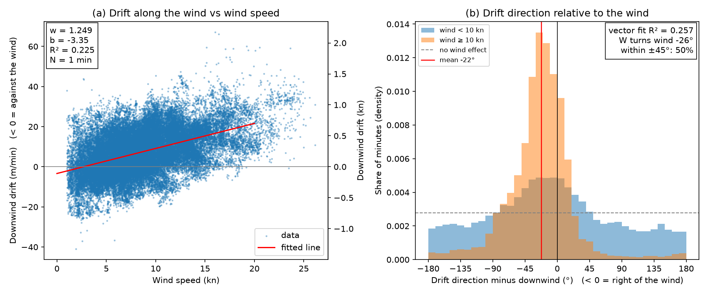
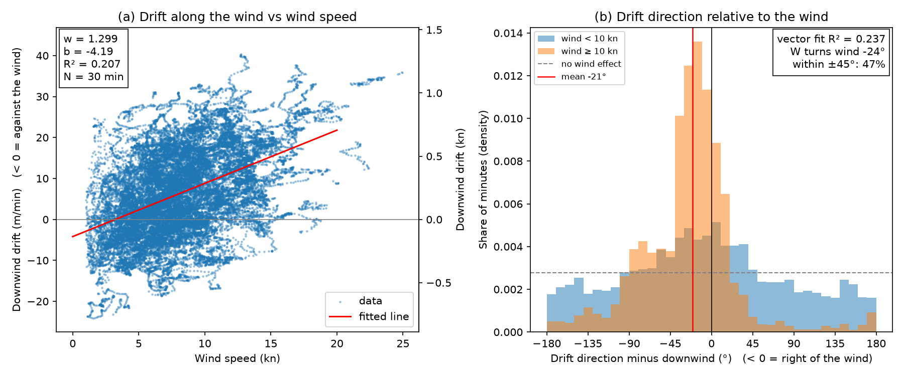
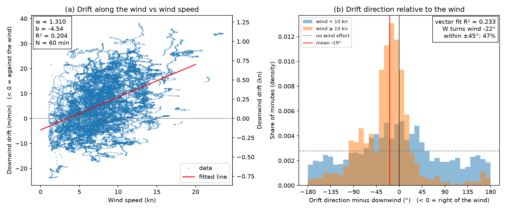
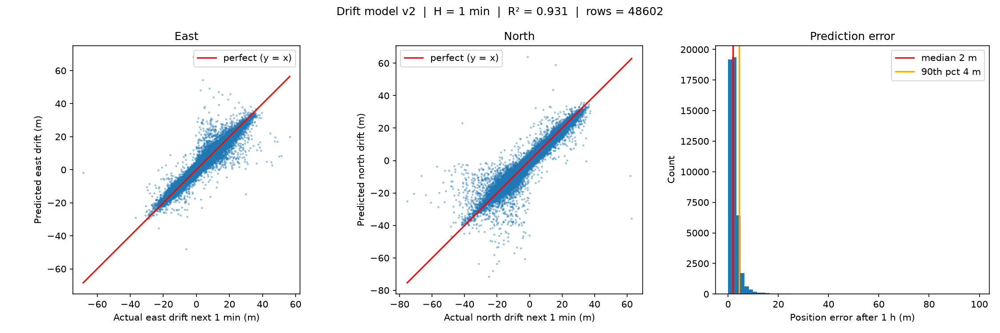
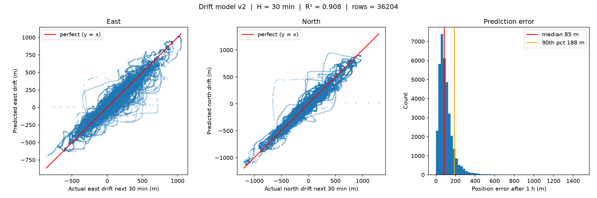
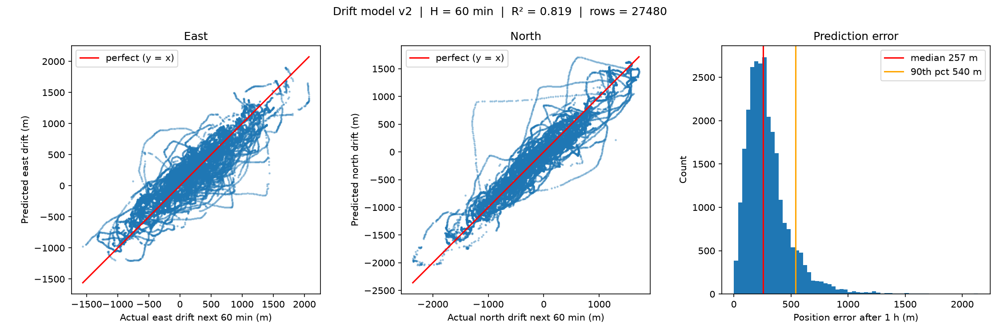
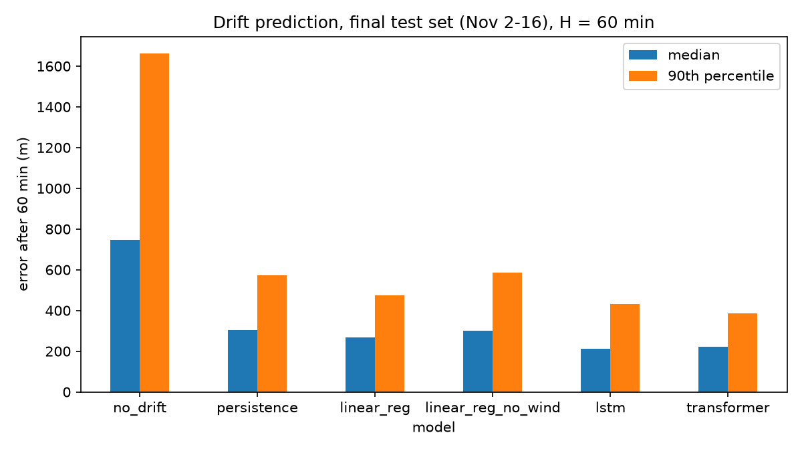

# Predicting Remote Intervention for a Station-Keeping USV

Predict, from live telemetry, whether a remote pilot will need to intervene with an uncrewed surface vehicle (USV) within a future time horizon, so the pilot can be alerted on demand instead of kept on continuous watch.

Course project for SENG 474, University of Victoria.

## Overview

Open Ocean Robotics (OOR) operates the DataXplorer, a USV that must stay within 10 nautical miles (nm) of a retired weather buoy's position. It mostly drifts with its motor off, and a pilot watches it 24/7 although a course correction is needed only every two to three hours.

The project so far:

- **V1: Location check (complete).** A rule-based check of the USV's current position.
- **V2: One-hour drift prediction (Milestone 3).** Given the last hour of a drifting USV's movement and wind, predict where it will be in one hour. Linear regressions show what drives the drift; four models (persistence, linear regression, LSTM, transformer) are then compared on a deployment they never saw.
- **Evaluation (Milestone 4).** Evaluate the quality and validity of the prediction models

One command runs everything: see [Quick start](#quick-start). The longer description is under [Project background](#project-background).

## Illustrative sample

**Input:** the last 60 minutes of a drifting USV, one row per minute: metres moved east, metres moved north, and the wind's push east and north.

**Output:** how far it will move east and north over the next 60 minutes. The predicted position is the position now plus that movement.

An example from the test deployment, Oct 19 at 21:15. In the past hour the USV had moved 774 m east and 555 m north, and it was slowing down.

| | Movement over the next hour (east, north) | Distance from the real position |
|---|---|---|
| Persistence (next hour = last hour) | (774, 555) m | 609 m |
| LSTM | (460, 353) m | 238 m |
| What really happened | (283, 194) m | |

The LSTM reads the hour minute by minute, so it noticed the slowdown. Persistence assumes the last hour repeats.

## Prerequisites

- Python 3.13 (other recent versions may work; PyTorch does not always support the newest one)
- `bash` (macOS or Linux; on Windows use Git Bash or WSL)
- An internet connection the first time, to install the packages
- No GPU is needed

The packages are pinned in `requirements.txt`: numpy, pandas, scikit-learn, matplotlib, torch and pyproj.

## Installation

```bash
git clone https://github.com/jakecush1/autonomous-pilot-ML.git
cd autonomous-pilot-ML
```

The quick start below creates the Python environment and installs the packages by itself. To do it by hand instead:

```bash
python3.13 -m venv .venv
source .venv/bin/activate            # Windows: .venv\Scripts\activate
pip install -r requirements.txt
```

## Quick start

```bash
bash quickstart.sh
```

This sets up the environment the first time, then runs every step in order. It takes about 5 minutes on a laptop CPU.

| Step | What it runs | What you should see |
|---|---|---|
| `fits` | Both linear regressions: wind against drift speed and direction for every window N (1, 30, 60 min), and past drift + wind for every horizon H (1, 30, 60 min) | Each fit printed with its R², and the plots in `evaluation/results/linear_fits/`. These are the numbers under [What drives the drift?](#what-drives-the-drift-linear-regression) |
| `prep` | Cuts the telemetry in `data/raw/` into 60-minute motor-off windows | The number of windows in each split |
| `baselines` | No drift, persistence and linear regression | Their error on the validation and test deployments |
| `lstm`, `transformer` | Trains and scores each neural network | The loss per epoch, then the error; the trained models go to `output/` |
| `compare` | Puts all the scores together | The results table, and the chart `evaluation/results/comparison.png`. These are the numbers under [Four models on the final test set](#four-models-on-the-final-test-set) |

To use another Python version, put `PYTHON=` in front, for example `PYTHON=python3.12 bash quickstart.sh`.

**Running one part.** Name the steps you want:

```bash
bash quickstart.sh fits              # only the linear regressions
bash quickstart.sh prep lstm         # rebuild the windows, then train the LSTM
```

**One linear regression with your own horizon or window.** The number is in minutes. Each script prints its fit, saves its plot, and opens the plot in a window; close the window to finish.

```bash
source .venv/bin/activate
python src/linear_fits/drift_prediction.py 30    # past drift + wind -> movement over the next 30 minutes (default 60)
python src/linear_fits/drift_vs_wind.py 10      # wind -> drift speed and direction over 10 minutes (default 60)
```

**V1 location check.** It asks for the USV's latitude and longitude and the wind direction.

```bash
python src/location_check/location_check.py
```

## Results

### What drives the drift? (linear regression)

**Wind speed alone explains little; wind direction explains about twice as much.** `src/linear_fits/drift_vs_wind.py` measures the drift over a window of N minutes and uses motor-off minutes where the whole window has no gaps, the motor off every minute, no tow-speed movement and at least 1 kn of wind. It fits three things on the same rows:

- **speed:** drift speed = w · wind speed + b (printed only, for comparison)
- **downwind:** drift **along the wind** = w · wind speed + b (plot a)
- **vector:** drift (east, north) = W · wind push (east, north) + c, where c is the average current (plot b)

| N (min) | Rows | Speed R² | Downwind w (m/min per kn) | Downwind R² | Vector R² | W turns the wind | With the wind (±45°, all / ≥ 10 kn) |
|---|---|---|---|---|---|---|---|
| 1 | 49,644 | 0.115 | 1.249 (4.0% of wind) | 0.225 | 0.257 | 26° clockwise | 50% / 72% |
| 30 | 33,320 | 0.109 | 1.299 (4.2%) | 0.207 | 0.237 | 24° clockwise | 48% / 70% |
| **60** | 25,640 | 0.112 | 1.310 (4.2%) | 0.204 | 0.233 | 22° clockwise | 47% / 67% |

- Speed against speed explains only about 11% of the drift at every window. It mixes current into every reading regardless of direction, so it understates the wind (slope about 2.1% of wind speed).
- The part of the drift that goes with the wind rises about 4% of the wind speed per knot, and wind explains about twice as much of it (R² 0.20–0.23).
- **Share of time drifting with the wind** (drift direction within ±45° of downwind; 25% if wind had no effect on direction):

  | Wind | N = 1 min | N = 30 min | **N = 60 min** | Share of minutes (N = 60) |
  |---|---|---|---|---|
  | 1–5 kn | 25% | 22% | 20% | 19% |
  | 5–10 kn | 46% | 45% | 45% | 55% |
  | 10–15 kn | 70% | 67% | 64% | 23% |
  | ≥ 15 kn | 81% | 84% | 87% | 3% |
  | all | 50% | 47% | 47% | 100% |

  Below 5 kn the drift direction is no better than chance, so current decides where the USV goes. The share then rises with the wind, to 87% of the time at 15 kn or more.
- The drift is on average 20–25° to the **right** of downwind, as Ekman drift predicts in the Northern Hemisphere. This matches the clockwise turn in the past-drift fit below.
- The results barely change with N, so they are not an artefact of GPS noise (short N) or of averaging (long N). Wind still explains only about a quarter of the drift; the rest is current and tide. In some periods (Jun 11–15, Oct 16 and Oct 22) the USV drifts mostly against the wind.

N = 1 minute:



N = 30 minutes:



N = 60 minutes (used in the report):



**Past drift plus wind predicts much better, and the horizon H matters.** The fit predicts the movement east and north over the next H minutes from the movement over the past H minutes and the wind vector.

| H (min) | R² | Median error (m) | 90th percentile (m) | Samples |
|---|---|---|---|---|
| 1 | 0.93 | 2 | 4 | 48,602 |
| 30 | 0.91 | 85 | 188 | 36,204 |
| 60 | 0.82 | 257 | 540 | 27,480 |

- The longer the horizon, the weaker the fit, because wind and current have longer to change.
- We keep H = 60 because a pilot needs about an hour of warning.
- At H = 60 the next hour's drift is 0.84–0.92 of the last hour's, turned slightly clockwise. Past drift captures current and tide without measuring them.

H = 1 minute:



H = 30 minutes:



H = 60 minutes:



These numbers are measured on the same data the fits were trained on, so they are optimistic. The next table is the test on unseen data.

### Four models on the final test set

Position error after 60 minutes on the final test set (the two November deployments, Nov 2–9 and Nov 11–16), which no model or choice saw before. The models train on April to Oct 13 and stop early on the latest development deployment (Oct 16–23):

| Model | Median (m) | 90th percentile (m) | R² |
|---|---|---|---|
| No drift (stays put) | 747 | 1663 | −0.01 |
| Persistence (next hour = last hour) | 305 | 572 | 0.87 |
| Linear regression | 269 | 476 | 0.90 |
| Linear regression without wind | 301 | 587 | 0.86 |
| **LSTM** | **213** | 433 | 0.92 |
| Transformer | 222 | **387** | **0.93** |

- Persistence already more than halves the error of assuming no drift.
- The LSTM and transformer beat every baseline: the LSTM has the lowest median error (30% below persistence, 21% below linear regression), the transformer the lowest 90th percentile (32% below persistence).
- Linear regression beats persistence in November, but only with its wind features: without them it is no better than persistence. On the calmer validation week it did not beat persistence (320 m vs 294 m). November was much windier (73% of hours with wind of 10 kn or more, against 34% in the validation week), and wind steers the drift mainly in strong wind (see *What drives the drift?*).
- With one seed per model, the 9 m gap between the LSTM and transformer may be noise.



More detail is in the write-ups in `evaluation/reports/` and in the Milestone 3 report in `docs/3_Solution_Jake_Rowan`.


## File structure

- `src` - the code: our learned ML models, which test and run multiple different models, and the location checker
- `data` - the telemetry the models learn from
- `output` - the trained models
- `evaluation` - results (scores and charts) and write-ups
- `docs` - written documents for each stage of the project, and summaries of related literature
- `legacy` - earlier work that the code in `src` replaced

```
autonomous-pilot-ML/
├── README.md
├── requirements.txt                # the packages, pinned
├── quickstart.sh                   # one command: set up, then run everything
├── data/
│   ├── raw/                        # seven deployments of 1-minute telemetry (Apr-Oct 2026)
│   ├── preprocessed/               # the 60-minute windows built from them (made by the `prep` step)
│   └── holdout/                    # the two latest deployments (Nov 2-9, Nov 11-16), kept unseen for the final test
├── src/
│   ├── main.py                     # runs every step, or the ones you name
│   ├── cmn/                        # shared: loading, cleaning, windows, split, error in metres
│   ├── linear_fits/                # linear regressions: what drives drift, and the effect of the horizon H
│   ├── models/                     # persistence, linear regression, LSTM, transformer
│   ├── evaluate/                   # results table and chart
│   └── location_check/             # V1: rule-based check of the current position
├── output/                         # trained LSTM and transformer
├── evaluation/
│   ├── results/                    # scores (results.json), comparison chart, linear-fit plots
│   └── reports/                    # write-ups of the linear fits and of the model comparison
├── docs/
│   ├── 1_Proposal_Jake_Rowan/      # Milestone 1 report (LaTeX + PDF)
│   ├── 2_Background_Jake_Rowan/    # Milestone 2 report (LaTeX + PDF)
│   ├── 3_Solution_Jake_Rowan/      # Milestone 3 report (LaTeX + PDF), and its first draft
│   ├── summaries/                  # notes on the papers we reviewed
│   ├── notes/                      # planning notes
│   └── examples/                   # course manuals and sample reports
└── legacy/                         # the earlier hourly drift model and templates
```

## Milestones

- [x] Milestone 1: project proposal
- [x] Milestone 2: background and related work
- [x] V1 location check
- [x] Milestone 3: proposed solution (one-hour drift prediction)
- [ ] Milestone 4: evaluation, including the held-out November deployment
- [ ] Milestone 5: 3-minute talk

## Team

- Jake Cushway, University of Victoria
- Rowan Hall, University of Victoria

Individual contributions are tracked through assigned issues and commit history in this repository. AI use for Milestone 3 is declared in the report's footnote.

## Citation

```bibtex
@misc{cushway2026usvdrift,
  author = {Cushway, Jake and Hall, Rowan},
  title  = {Predicting One-Hour Drift for a Station-Keeping USV},
  year   = {2026},
  note   = {SENG 474 course project, University of Victoria},
  url    = {https://github.com/jakecush1/autonomous-pilot-ML}
}
```

## License

Released under [CC BY-NC-SA 4.0](https://creativecommons.org/licenses/by-nc-sa/4.0/).
