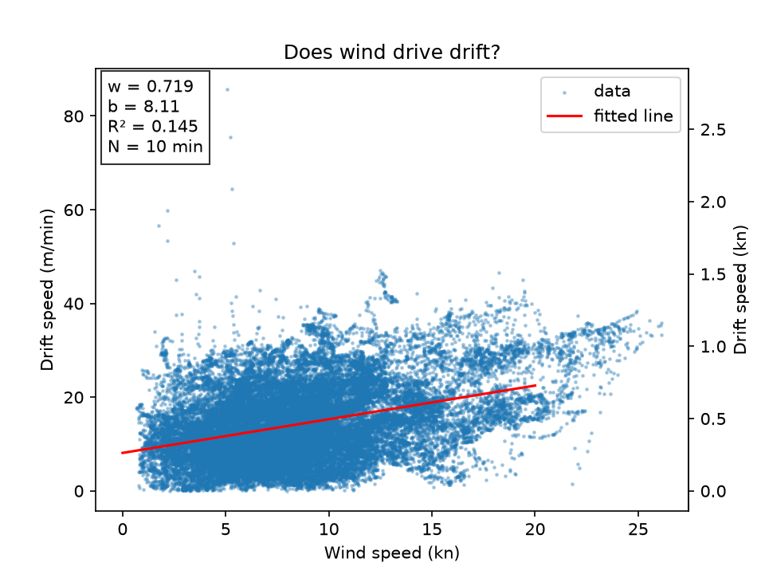

# Predicting Remote Intervention for a Station-Keeping USV

Predict, from live telemetry, whether a remote pilot will need to intervene with an uncrewed surface vehicle (USV) within a future time horizon, so the pilot can be alerted on demand instead of kept on continuous watch.

Course project for SENG 474, University of Victoria.

## Quick start

Two scripts run all the code. Each one sets up its own Python environment the first time it runs, so nothing needs to be installed by hand.

```bash
git clone https://github.com/jakecush1/autonomous-pilot-ML.git
cd autonomous-pilot-ML

bash usv-intervention/solution/jake/quickstart.sh     # linear regressions, about 2 minutes
bash usv-intervention/solution/rowan/quickstart.sh    # four-model comparison, about 5 minutes
```

| Script | What it runs | What you should see |
|---|---|---|
| `jake/quickstart.sh` | Both linear regressions, for every window N (1, 5, 10, 30, 60 min) and every horizon H (1, 30, 60 min) | Each fit printed with its R², and a plot saved next to each script. These are the numbers under [What drives the drift?](#what-drives-the-drift-linear-regression) |
| `rowan/quickstart.sh` | Data preparation, the baselines, linear regression, the LSTM, the transformer and the comparison | The results table printed, and the chart `outputs/comparison.png`. These are the numbers under [Four models on an unseen deployment](#four-models-on-an-unseen-deployment) |

Both need an internet connection the first time, to install their packages. They look for `python3.13`; to use another version, put `PYTHON=` in front of the command, for example `PYTHON=python3.12 bash usv-intervention/solution/rowan/quickstart.sh`.

## File structure

- `docs` - written documents for each stage of the project
- `summaries` - summaries of related literature
- `usv-intervention`
  - `solution` - our learned ML models, which test and run multiple different models
  - `v1_location_check` - a checker for the quality of a drifting USV's position

```
autonomous-pilot-ML/
├── docs/
│   ├── 1_Proposal_Jake_Rowan/      # Milestone 1 report (LaTeX + PDF)
│   ├── 2_Background_Jake_Rowan/    # Milestone 2 report (LaTeX + PDF)
│   ├── 3_Solution_Jake_Rowan/      # Milestone 3 report (LaTeX + PDF)
│   └── examples/                   # course manuals and sample reports
├── summaries/                      # notes on the papers we reviewed
├── usv-intervention/
│   ├── v1_location_check/          # V1: rule-based check of the current position
│   └── solution/                   # V2: one-hour drift prediction (Milestone 3)
│       ├── data/                   # five deployments of 1-minute telemetry (Apr-Oct 2026)
│       ├── data_holdout/           # a sixth deployment (Nov 2-9), kept unseen for the final test
│       ├── jake/                   # linear regressions: what drives drift, and the effect of the horizon H
│       │   ├── quickstart.sh       # runs every fit
│       │   └── linear-reg/         # the two scripts, their notes and plots
│       └── rowan/                  # pipeline: data prep, baselines, LSTM, transformer, comparison
│           ├── quickstart.sh       # runs the whole pipeline
│           └── docs/3/             # first draft of the Milestone 3 report
├── requirements.txt
└── update.sh                       # commit-and-push helper
```

## Background

Open Ocean Robotics (OOR) operates the DataXplorer, a USV that reports marine weather data for NOAA in place of the discontinued Station 46012 buoy. The vessel's only hard operating constraint is to remain within 10 nautical miles (nm) of the buoy's former position.

A remote pilot currently watches the vessel 24/7, roughly 1,095 eight-hour shifts per year, even though a corrective navigation command is needed only every two to three hours. This project asks whether that decision can be predicted from telemetry, turning a continuous watch into an on-call, alert-driven one.

The model is **advisory only**. It decides *whether* a pilot is needed, never *what* the pilot should do, and all navigation decisions stay with a human.

## Problem Definition

Let $p_0$ be the station point and $p$ the vehicle's reported position, each a latitude–longitude pair. Local wind is given by speed $v \ge 0$ (knots) and direction $\theta \in [0^\circ, 360^\circ)$, measured clockwise from true North as the direction the wind blows *from*.

A state is $\mathbf{s} = (p, p_0, v, \theta)$. Let $d(\mathbf{s})$ be the geodesic distance from $p$ to $p_0$; the operating constraint is $d(\mathbf{s}) \le R = 10$ nm.

For a horizon $\Delta t > 0$, the goal is a decision function

$$f: \mathcal{S} \rightarrow \{0, 1\}$$

where $f(\mathbf{s}) = 1$ if a pilot must issue a corrective command within $[t, t + \Delta t]$ to keep the vehicle inside $R$, and $0$ otherwise.

**Building block: drift prediction.** Before deciding *when* a pilot must act, we predict *where* the drifting vessel will be. Given the last $H$ minutes of its movement and the wind (motor off), a function

$$g: \mathbb{R}^{H \times 4} \rightarrow \mathbb{R}^{2}$$

predicts how far it will move east and north over the next $H$ minutes. We use $H = 60$. The predicted position can then be checked against the 10 nm limit.

## Approach

**V1: Location check (complete).** A rule-based check of the USV's current position. It converts latitude and longitude to nautical miles east and north of the station and flags a position that is outside 10 nm, in the traffic lane (more than 6.5 nm east), within 1 nm of the limit, or more than 6 nm from the centre. It also reports whether the wind is pushing the USV toward the centre or away from it. It looks only at the present position and makes no prediction. Code: `usv-intervention/v1_location_check/usv2.py`.

**V2: One-hour drift prediction (Milestone 3).** Code: `usv-intervention/solution`. It has two parts:

1. **Linear regressions** (`jake/linear-reg`): simple fits that show what drives the drift and how the prediction horizon $H$ changes the result.
2. **Model comparison** (`rowan`): persistence ("next hour = last hour"), linear regression, an LSTM and a transformer, trained on three deployments and tested on a deployment they never saw.

**Next (Milestone 4): from predicted position to an alert.** Turn the predicted position into a time until the vessel reaches the 10 nm limit and a probability that the pilot must act, and score the models once on the held-out November deployment.

**Out of scope:** reinforcement learning for direct navigation control. A V2 model could later serve as a safety monitor for such an agent.

## Results so far

### What drives the drift? (linear regression)

**Wind speed alone explains little.** The fit is `drift speed = w · wind speed + b` on motor-off minutes, with drift speed measured over a window of N minutes.

| N (min) | w (m/min per kn) | b (m/min) | R² |
|---|---|---|---|
| 1 | 0.692 | 8.35 | 0.125 |
| 5 | 0.728 | 8.08 | 0.144 |
| **10** | 0.719 | 8.11 | **0.145** |
| 30 | 0.663 | 8.29 | 0.127 |
| 60 | 0.582 | 8.56 | 0.104 |

- Wind speed explains at most 15% of the variation in drift speed. A 10-minute window is best: shorter windows carry GPS noise, and over longer ones the wind and current change.
- The slope is about 2.3% of the wind speed.
- With no wind the USV still drifts at about 8 m/min (0.26 kn), so current matters at least as much as wind.



**Past drift plus wind predicts much better, and the horizon H matters.** The fit predicts the movement east and north over the next H minutes from the movement over the past H minutes and the wind vector.

| H (min) | R² | Median error (m) | 90th percentile (m) | Samples |
|---|---|---|---|---|
| 1 | 0.93 | 2 | 4 | 35,974 |
| 30 | 0.91 | 87 | 194 | 27,332 |
| 60 | 0.83 | 256 | 549 | 21,076 |

- The longer the horizon, the weaker the fit, because wind and current have longer to change.
- We keep H = 60 because a pilot needs about an hour of warning.
- At H = 60 the next hour's drift is 0.84–0.92 of the last hour's, turned slightly clockwise. Past drift captures current and tide without measuring them.

H = 1 minute:


H = 30 minutes:


H = 60 minutes:


These numbers are measured on the same data the fits were trained on, so they are optimistic. The next table is the test on unseen data.

### Four models on an unseen deployment

Position error after 60 minutes on the test deployment (Oct 16–23), which no model saw during training:

| Model | Median (m) | 90th percentile (m) | R² |
|---|---|---|---|
| No drift (stays put) | 586 | 1515 | 0.00 |
| Persistence (next hour = last hour) | 294 | 570 | 0.80 |
| Linear regression | 318 | 631 | 0.77 |
| LSTM | 247 | 497 | 0.85 |
| **Transformer** | **246** | **477** | **0.86** |

- Persistence already halves the error of assuming no drift.
- Linear regression does not beat persistence on unseen data: its R² of 0.83 on training data falls to 0.77.
- The LSTM and transformer both beat persistence by about 16%, and are tied with each other.


More detail is in `usv-intervention/solution/rowan/README.md` and in the Milestone 3 report in `docs/3_Solution_Jake_Rowan`.

## Evaluation

Drift predictions are scored by endpoint error: the distance in metres between the predicted and the real position after 60 minutes, reported as the median and the 90th percentile.

The intervention model will be compared against the V1 location check on:

- **Interventions caught:** the fraction of real interventions the model alerts on in advance (recall).
- **Unnecessary alerts:** false alerts raised per shift.
- **Watch time removed:** hours of continuous monitoring the alert system replaces.

Errors are asymmetric. A missed intervention risks the station-keeping constraint, while a false alert costs one page, so recall on real interventions is weighted above alert precision.

## Running one part at a time

The [quick start](#quick-start) at the top runs everything. The steps below run a single piece.

**One linear regression.** Run each script from its own folder, after `jake/quickstart.sh` has created the environment. The number is the horizon H or the window N in minutes. Each script prints its fit, saves its plot, and opens the plot in a window; close the window to finish.

```bash
cd usv-intervention/solution/jake
source .venv/bin/activate            # Windows: .venv\Scripts\activate

cd linear-reg/drift-prediction
python future.py 30                  # past drift + wind -> movement over the next 30 minutes (default 60)

cd ../drift-vs-wind
python linear-reg.py 5               # wind speed -> drift speed over 5 minutes (default 10)
```

**One step of the model comparison.** The steps are listed in `usv-intervention/solution/rowan/README.md`.

**V1 location check.** It asks for the USV's latitude and longitude and the wind direction. Run it from the top folder of the repository.

```bash
python -m venv .venv
source .venv/bin/activate            # Windows: .venv\Scripts\activate
pip install -r requirements.txt
python usv-intervention/v1_location_check/usv2.py
```

## Milestones

- [x] Milestone 1: project proposal
- [x] Milestone 2: background and related work
- [x] V1 location check
- [x] Milestone 3: proposed solution (one-hour drift prediction)
- [ ] Milestone 4: evaluation, including the held-out November deployment
- [ ] Milestone 5: 3-minute talk

## Team

- Jake Cushway, University of Victoria
- Rowan Hall, University of Victoria

Individual contributions are tracked through assigned issues and commit history in this repository. AI use for Milestone 3 is declared in the report's footnote.

## License

Released under [CC BY-NC-SA 4.0](https://creativecommons.org/licenses/by-nc-sa/4.0/).
